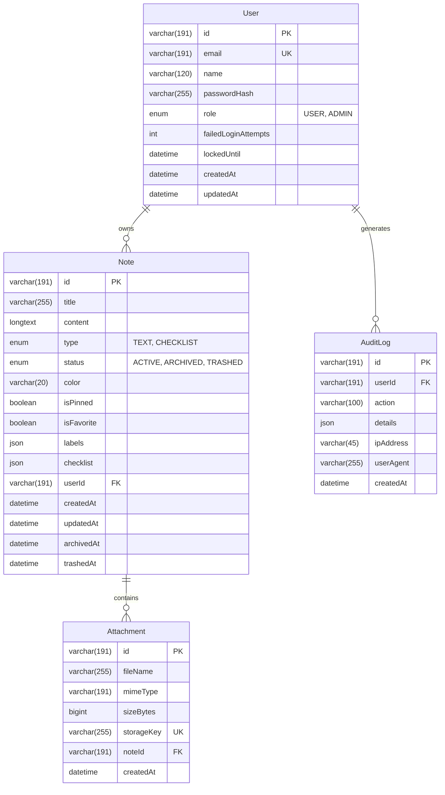

# Mela Note — MySQL Database Schema

All database structures are managed through Prisma ORM on **MySQL 8.4** (or MariaDB LTS).

## ER Diagram (Mermaid)

## Schema Details
- **User**: Stores credentials and role. `passwordHash` holds Argon2id hashes (or legacy bcrypt for transparent upgrade). `failedLoginAttempts` and `lockedUntil` enforce brute-force protection.
- **Note**: Notes support Markdown text, colored cards, pin sorting, and embedded JSON checklists and label arrays.
- **Attachment**: Attached files linked to a specific note. Physical files stored on disk using unique UUID keys; never accessed without an ownership check.
- **AuditLog**: Immutable security audit records.
